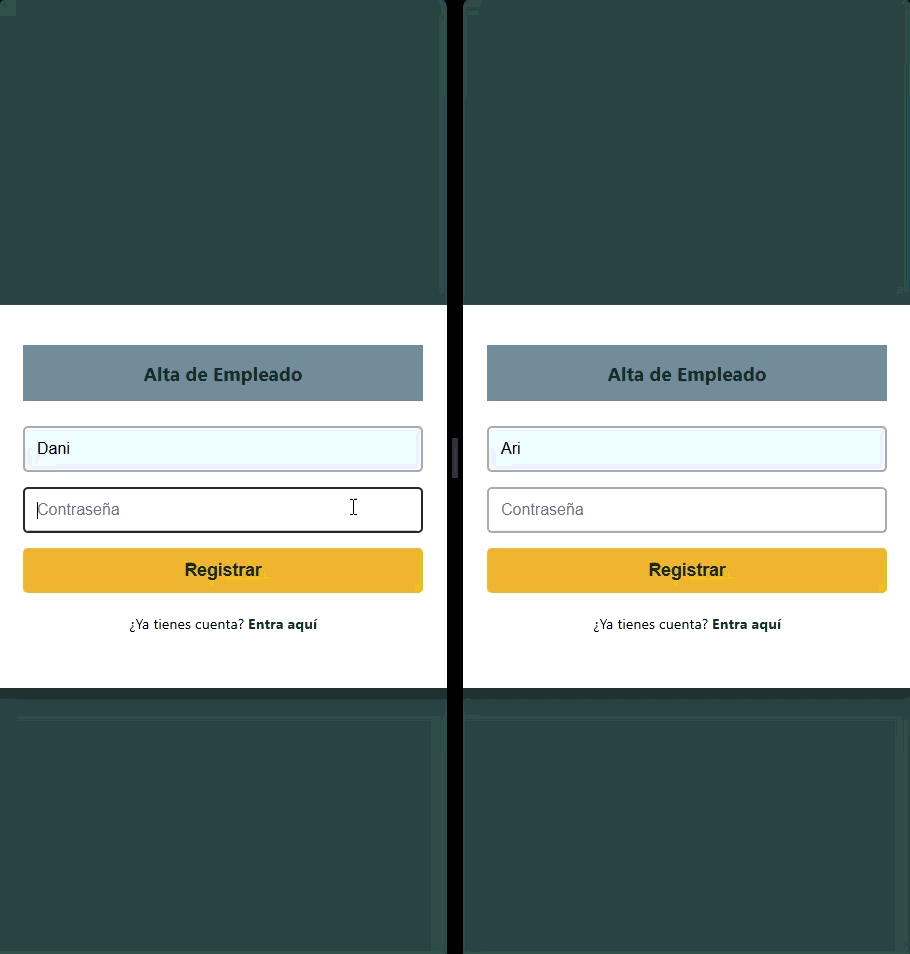

# PROYECTO CHAT SOPORTE TI / IT SUPPORT CHAT PROJECT 

[Versión en Español](#-español) | [English Version](#-english)

---

## Español

Es una app de chat al estilo WhatsApp muy primigenio. La he construido para aprender y descubrir cómo funcionan las conexiones bidireccionales en tiempo real (WebSockets).

Aquí podemos ver el funcionamiento de este chat:

----------------- CHAT FUNCIONANDO -----------------

----------------------------------------------------

### Stack Tecnológico
- **Backend:** Python, Flask, Flask-SocketIO.
- **Base de Datos:** SQLAlchemy (SQLite).
- **Frontend:** Vanilla JavaScript, HTML, CSS (Flexbox).

### Notas y Decisiones de Desarrollo

- **Alcance del proyecto:** El chat permite registrarse y hacer login. Al ser principalmente una prueba para entender cómo se comunican los WebSockets, decidí no implementar la gestión/eliminación de usuarios para mantener el foco en la comunicación en tiempo real.
- **Limpieza de dependencias:** Al principio usé Flasgger para probar si el backend respondía correctamente antes de levantar los cimientos. Cuando el proyecto escaló al 100% hacia WebSockets, Flasgger quedó obsoleto, así que lo eliminé del código y del `requirements.txt` para no arrastrar dependencias muertas.
- **Auditoría de Seguridad (XSS):** Haciendo pruebas con el texto, le pasé el código a Gemini y Claude para detectar si habían errores en las funcionalidades. Descubrí que se podía inyectar código malicioso (vulnerabilidad XSS), así que decidí implementar una función en JavaScript que convierte todo a texto "plano" (escapando el HTML) para evitar estas inyecciones.
- **Base de datos efímera:** Al ser un proyecto de portafolio público, configuré SQLAlchemy para hacer un `drop_all()` en cada reinicio del servidor. Así el servidor siempre empieza limpio y cualquiera puede probar la funcionalidad del chat. Una vez saciada mi curiosidad técnica, no era necesario guardar ninguna base de datos persistente.

### Instalación local
1. Clona el repositorio: `git clone [tu-url-aqui]`
2. Instala las dependencias: `pip install -r requirements.txt`
3. Ejecuta el servidor: `python app.py`

---

## English

This is a very early-stage WhatsApp-style chat app. I built it to learn and discover how real-time bidirectional connections (WebSockets) work.

Here you can see the chat in action:

----------------- CHAT IN ACTION -----------------

----------------------------------------------------

### Tech Stack
- **Backend:** Python, Flask, Flask-SocketIO.
- **Database:** SQLAlchemy (SQLite).
- **Frontend:** Vanilla JavaScript, HTML, CSS (Flexbox).

### Development Notes & Decisions

- **Project scope:** The chat allows users to register and log in. Since this was primarily a test to understand how WebSockets communicate, I decided not to implement user management/deletion to keep the focus on real-time communication.
- **Dependency cleanup:** At first, I used Flasgger to test if the backend was responding correctly before laying the foundations. When the project scaled 100% towards WebSockets, Flasgger became obsolete, so I removed it from the code and the `requirements.txt` to avoid dragging dead dependencies.
- **Security Audit (XSS):** While testing the text input, I passed the code to Gemini and Claude to detect any functional errors. I discovered that malicious code could be injected (XSS vulnerability), so I decided to implement a pure JavaScript function that converts everything to "plain" text (escaping HTML) to prevent these injections.
- **Ephemeral database:** Since this is a public portfolio project, I configured SQLAlchemy to run a `drop_all()` on every server restart. This way, the server always starts clean and anyone can test the chat functionality. Once my technical curiosity was satisfied, there was no need to keep a persistent database.

### Local Installation
1. Clone the repository: `git clone [your-url-here]`
2. Install dependencies: `pip install -r requirements.txt`
3. Run the server: `python app.py`
